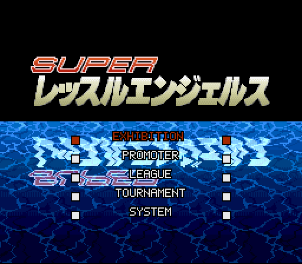
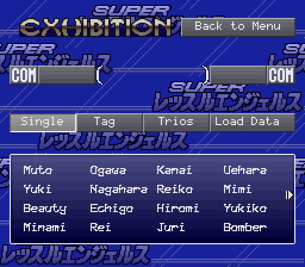
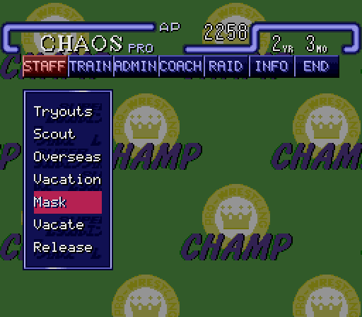
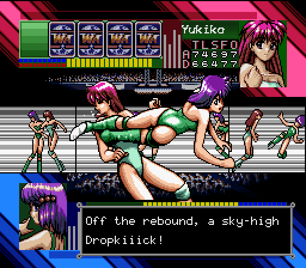
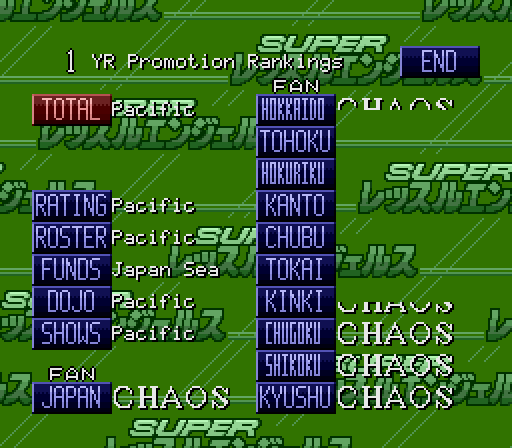
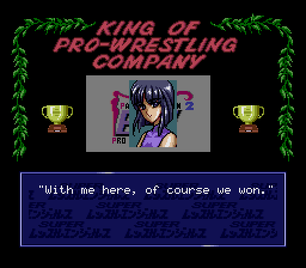
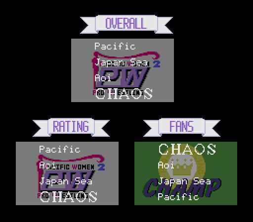

# Screenshots

Super Wrestle Angels with the English patch, taken in Mesen 2.

## Title menu

The mode names, redrawn in the menu's own outlined letters.

## Exhibition

Match types, buttons and the wrestler list.

## Promoter mode

The menu bar and header are relettered graphics; the menus are the game's 12x12 font, two
letters to a glyph.

## A match

Match commentary, at most 28 letters to a line.

## Year-end rankings

Every April of a multi-year game: 18 buttons redrawn, with the regions of Japan.

## The ending

The winning promotion's wrestlers have their say.

## Awards

The ending's award banners.
